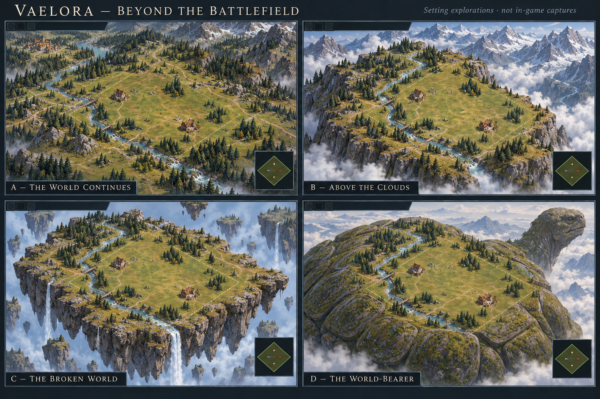

# Vaelora: beyond the battlefield

[Creative direction](../../creative-direction.md) · [World overview](../../lore/world.md) · [Map composition](../../map-authoring.md#organic-landscape-composition)

14 October 2026. **Exploration, not selected cosmology or implemented scenery.**
Owner: this chat, `01a13aba-1a70-7322-9b8e-f71bb213dccd`.

The user reports that clean square/diamond maps float into oblivion and asks
what physically surrounds or supports the battlefield. The intended feeling is
a place within Vaelora, with a life and landscape beyond the match. A bounded
comparison should help choose that setting before a renderer change.

This generated board is aspirational setting art. Its layouts, buildings,
topography and schematic HUD are illustrative; it is not an edit of gameplay,
an exact map layout, a new interface selection or an in-game capture.
Visual review: all four labels are readable and A/C/D distinguish continuing
land, detached fragments and a living bearer. B supplies a useful cloud-valley
treatment, but mist hides its connection to the distant range; a subsequent
study should make that attached ridge explicit. The central dashed lines are
editorial match-boundary annotations, not selected runtime decoration. The
board's generous outer scenery needs a separate ordinary-zoom comparison;
this broad view does not prove day-to-day command readability.

## What is present now

Source inspected at `97202f4b6c8e81ed0cccb54ec5b7270445bac9c5`:

- [Main scene](../../../src/main.js) uses the same sage `0x859175` for its
  background, distance fog and clear color. The renderer has an orthographic
  camera. A sky treatment alone would leave the rectangular ground termination.
- [Ground surfaces](../../../src/presentation/rendering/ground-surfaces.mjs)
  build a base exactly spanning map width/height. Main draws a four-sided pale
  outline at the boundary. [Cliff faces](../../../src/terrain-cliff-faces.mjs)
  describe internal elevation discontinuities; they do not supply an outer
  geological skirt beneath the whole map.
- [Camera bounds](../../../src/camera-controls.mjs) allow a six-world-unit
  target margin plus the HUD anchor offset. Target bounds are not viewport
  bounds: zoom, aspect ratio and Fit map can expose much more background.
- Ordinary fresh human entry uses Veyrholds / Terraced Vale Tiny according to
  the [current map catalog](../../maps.md#terraced-vale-tiny-baseline).

Two retained images were visually inspected: the
[30 September Veyrholds strategic renderer study](../../qa-evidence/vaelora-veyrholds-understory-2026-09-30/veyrholds-renderer-strategic.png)
shows the abrupt diamond/sage separation; the
[11 October ordinary Worker repair capture](../../qa-evidence/interaction-audio-2026-10-11/roster-eleventh-cloud-attempt2/roster-audio/ordinary-game.png)
shows that edge beside the actual HUD. The latter uses a flat roster/audio
fixture, not Terraced Vale, and its receipt pins expected source
`e24c8a56dc7ee251ccc0e5553f89aaa2401b8965` with deployed revision/release digest
unavailable. These are historical observations, not a fresh current-build pass.

## Four directions

| Direction | What supports and surrounds the map | Story implication | Recommendation |
| --- | --- | --- | --- |
| **A — The world continues** | Irregular scenic foothills, woodland and rivers extend beyond the match into quieter atmospheric distance. No exposed slab. | This is a bounded battle inside a much larger inhabited landscape. It leaves the world's shape open. | Recommended foundation. Strongest fit with the existing regional atlas and creative spine. |
| **B — Above the clouds** | An attached highland shelf has weathered escarpments, lower slopes and a cloud-filled valley. Distant ridges keep it connected to geography. | Settlements occupy exposed uplands. Cloud height is local weather, not proof of a suspended world. | Recommended Veyrholds variation; compare a light version with A first. |
| **C — The broken world** | Irregular earth fragments have visible rocky undersides; rivers fall off broken cliffs into mist, with distant fragments beyond. | Detachment, falling water and the absent lower world need deliberate cosmological development. A single exceptional location need not explain all Vaelora. | Retain as a bolder alternative, potentially for an exceptional region. |
| **D — The world-bearer** | Mossy shell plates continue below inhabited land; a colossal tortoise's neck/head establishes bodily scale above cloud or sea. | A living bearer becomes a major premise with material consequences for habitation, water and movement. | Retain as a full alternate premise. It is much larger than a background treatment. |

The [selected Veyrholds painting](../vaelora-v1/veyrholds-map.png) already places
inhabited valleys, pines, bridges and waterways inside extensive mountain
geography. A/B reuse its material logic. C/D are new comparisons prompted by
the user and remain exploratory. The [voice bible](../../lore-voice-bible.md)
favors physical, materially strange particulars and deliberate cosmology
selection. No reviewed guide establishes a flat world, world tortoise or one
universal cosmic catastrophe.

## Recommended treatment

Make **a match a bounded area of a larger world** the working experiment. Use
three layers: readable playable ground; a narrow irregular scenic transition;
and subdued distant land/water/atmosphere. The simulation can keep its rectangular
bounds while the visible composition extends beyond them.

Let the region choose that transition: Veyrholds has scree, escarpments, distant
ridges and low valley haze; Bellweather has hedgerows, field margins and wooded
hills; Underbough has dense outer canopy and roots; Siltmouths has reed banks,
tidal flats and continuing muted water. These are proposals derived from the
[selected regional atlas](../vaelora-v1/README.md), not four production requests.
Stars or swirling space could suit an exceptional astronomical or supernatural
setting, but using them everywhere would make a cosmological claim and compete
with the regions' existing character.

Keep scenic terrain lower in contrast and detail than the battlefield. This
applies Riot's [clarity and visual-hierarchy principles](https://www.leagueoflegends.com/en-us/news/dev/clarity-in-league/)
(12 March 2021; read 14 October 2026) to our own setting; no Riot artwork is
imported. Decorative movement should not compete with commands or attacks.

## Smallest useful next experiment

Owner retained here for a subsequently requested implementation. First compare
A with a restrained B on **Terraced Vale Tiny**, using the existing orthographic
camera and HUD. Proposed bounded runtime scope: a new module under
`src/presentation/rendering/`, the main scene's composition/disposal seam, and
its required admission/release wiring. This exploration changes no runtime file.

The first experiment should show an uneven slate/soil skirt and a connected
outer ridge/valley, extending into muted regional distance. Fit map and an edge
pan must reveal that the land belongs somewhere. Keep the current boundary
cue until the scenic treatment makes the playable limit equally clear; a
hover/failure message can say "Beyond battlefield" if needed. Do not replace
all four straight limits with purported cliffs when the adjacent playable
terrain visibly contradicts that explanation.

Scenery must stay out of command picking, placement, pathfinding, harvest,
visibility and minimap facts. Preserve all playable cells and resources. Test
outside-ground clicks explicitly rather than allowing a decorative mesh to
redirect orders. Separate distance atmosphere from fog of war; scenery must not
derive from undisclosed enemy state. Keep tall forms outside projected playable
space so neither viewing team loses sight of edge units. Cloudless/static
scenery is sufficient for the first experiment; animation needs a separate
state/timing storyboard before production.

Acceptance for that future runtime slice: ordinary 0.91 and strategic 0.48 zoom,
Fit map, extreme edge pans and wide/narrow windows; both team views, unexplored
fog and visible troops at an edge. Verify no background void within allowed
views, no decorative selection/order targets, clear playable boundaries, no
obscured troops or washed-out cues, and bounded draw/asset cost. Use the existing
camera, terrain, input, fog and release checks, plus qualified cloud captures of
normal gameplay. Retain source SHA, clean release digest and deployed revision
separately through default adoption and identified in-game verification.

## Source delivery

Write scope: this source collection and one discovery link in the documentation
index. The exact [generation prompt](prompt.txt) and [source receipt](sources.json)
retain the three reference roles, observed hashes and generated image hash.
Method: built-in image generation, with local references. Original references
remain in place; the board is preserved unmodified in this directory.

[Scoped source validation](validation.json) records readable/differentiated
panels and the B/ordinary-scale limitations above. Documentation links passed
across 726 Markdown files and 5,737 local links before this final receipt link;
all five source/output/prompt hashes, the byte-exact generated copy, new text
whitespace and `git diff --check` passed. The CI registry was inspected; these
focused source checks do not claim the full CPU suite. No browser or game
server was launched for this exploration.

Runtime binding, release packaging, deployment and ordinary-game verification
are **N/A for this source exploration**. No setting has been adopted by default.
The next action is to select or refine a direction, then carry one bounded
Terraced Vale experiment through the runtime delivery described above.

Later on 14 October, the user selected A's larger connected landscape with
rocky edges and B's subtle valley clouds for an in-game Terraced Vale experiment.
The [runtime guide](../../battlefield-surround.md) and
[delivery evidence](../../qa-battlefield-surround-2026-10-14.md) own that subsequent
implementation. This preserves the source-only status of the original board;
it does not turn the other alternatives into selected lore.
