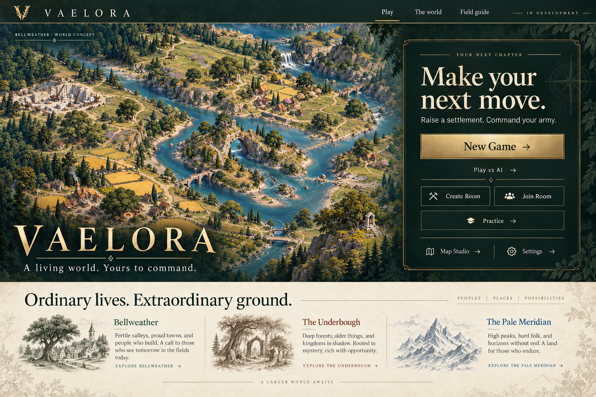
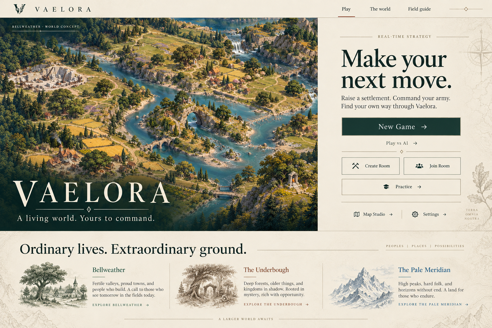
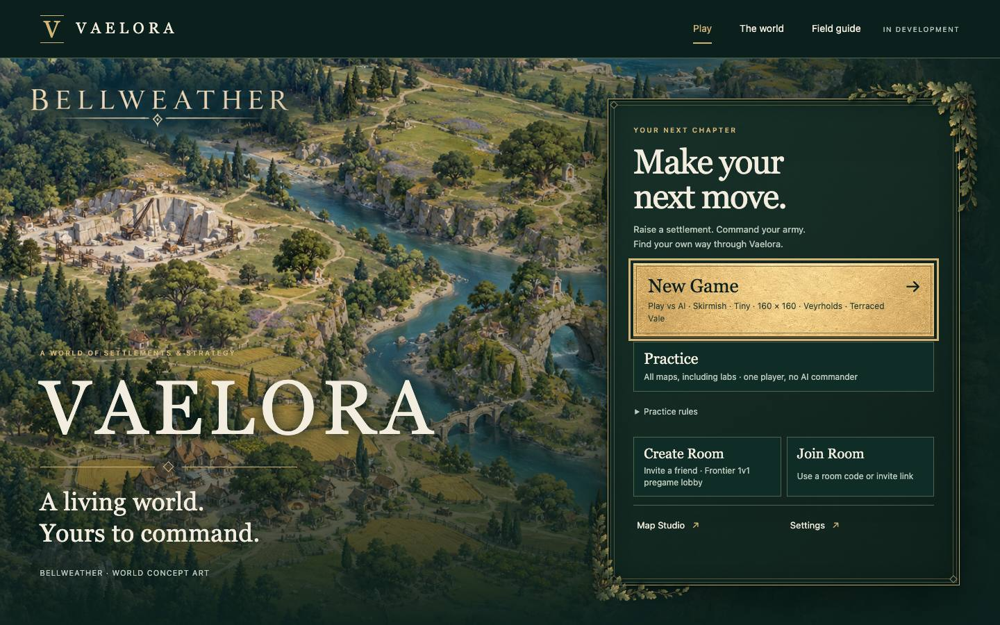
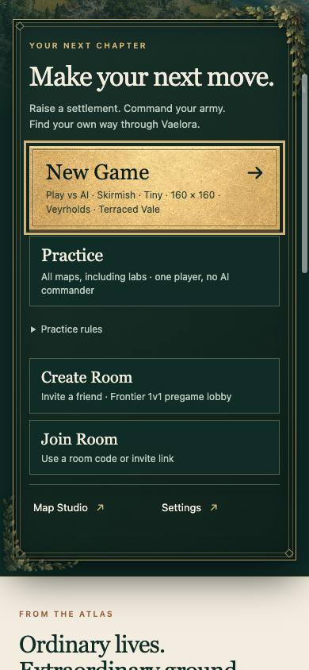
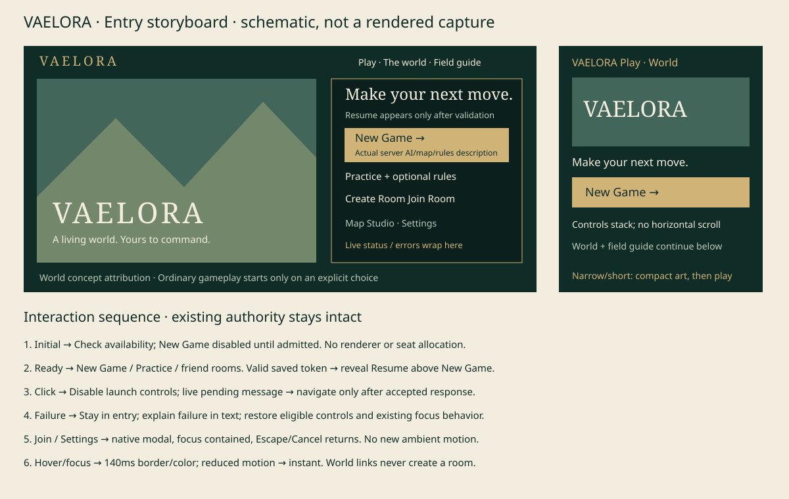

# Vaelora portal visual development

11 October 2026 · [Brand and interface bible](../../vaelora-brand.md)

The [brand and interface bible](../../vaelora-brand.md) now includes proposed
color roles, button families, states and material rules. Its
[interactive documentation reference](interface-reference.html) compares brass,
celadon and crimson entry actions using these preserved assets; the
[research note](brand-research.md) records sources and selection reasons.
These are internal documentation specimens, outside public game admission.

The user selected a world-first entry and then requested inspiration from
World of Warcraft and League of Legends: functional clients that feel part of
their worlds. **Immersive client study** is the selected implementation direction.
These are generated design studies, not screenshots or evidence of game use.

## Retained comparison

The earlier light atlas composition established the typography, warm reading
surface and world/action hierarchy. Its lighter launcher was superseded by the
pine-and-brass client frame after the user's reference direction.

## Provenance and interpretation

Both PNGs are unmodified built-in image-generation outputs made in the owning
chat. The input is the repository's preserved
[Bellweather painting](../vaelora-v1/bellweather-map.png), whose
[checkpoint](../vaelora-v1/README.md#production-use-and-provenance) records
original provenance. The second generation also used the first study as a
composition reference. No Blizzard or Riot art was supplied or copied.
Exact prompts are retained in [generation prompts](generation-prompts.txt).

The study's invented regional prose is not canon. Production copy comes from
the lore wiki. The painted crest and background map marks remain exploratory.
Production uses accessible live type and the unchanged approved Bellweather
image, with a visible concept caption.

## Material iteration — 11 October 2026

The user explicitly selected the textured New Game button, ornamental frame
and foliage, and requested separate resources to give the interface dimension.
Two original built-in image-generation outputs now support that treatment:

- [Brass surface](materials/brass-surface.png): quiet hammered gold for the
  primary action; the same surface under an opaque pine wash gives the panel
  a subtle material finish.
- [Oak corner](materials/oak-corner.png): sage oak leaves and acorns with actual
  transparency (80.58% fully transparent pixels), reused at two scales and
  orientations around the frame. Oak connects this treatment to Bellweather.

Both used the selected immersive study as their only style reference. The
[exact prompts](materials/prompts.txt) and [runtime manifest](../../../assets/ui/vaelora-brand-v1/materials-manifest.json)
retain provenance, source/runtime hashes and dimensions. Original PNGs remain
unchanged; lossless WebP encoding preserves decoded RGBA pixels and alpha.
No Blizzard or Riot resources were used.

The composition has five independent layers: landscape, dark material panel,
code-native brass rules, alpha foliage, and live controls. Frame and foliage
do not intercept input; they scale down on narrow layouts and disappear in
forced-color mode. The button retains distinct hover, pressed, pending and
keyboard-focus states. No decorative animation is introduced.

These are actual local browser captures of the implementation, taken with the
user's explicit portal-only exception to the Mac-testing restriction. They
are separate from the generated studies above. Deployment remains unverified;
the [QA record](../../qa-vaelora-brand-portal-2026-10-11.md) records scope and identity.

The storyboard is a code-authored schematic, not a browser capture. Check
1440×900, 1024×768, 390×844, 320px width and 200% zoom in the qualified browser.
Keep the full server description readable, the first action near the top,
conditional Resume available and dialogs within the visible viewport.
